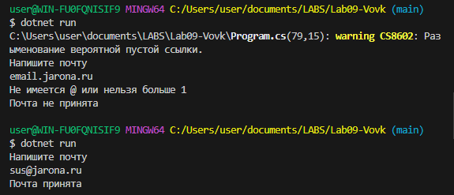
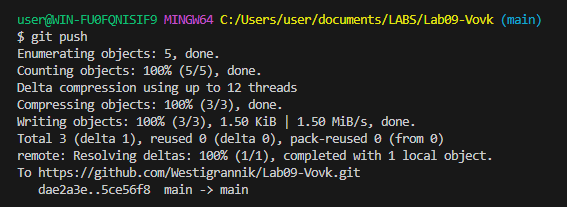

# Практическая работа №9
**ФИО: Вовк Тимофей Евгеньевич**
**Группа: ИСП-242**
**Дата:14.10.2026**
## Что изучено
- Изучили как пользоваться char
- Изучили как работать со строками
- Изучили срезы

